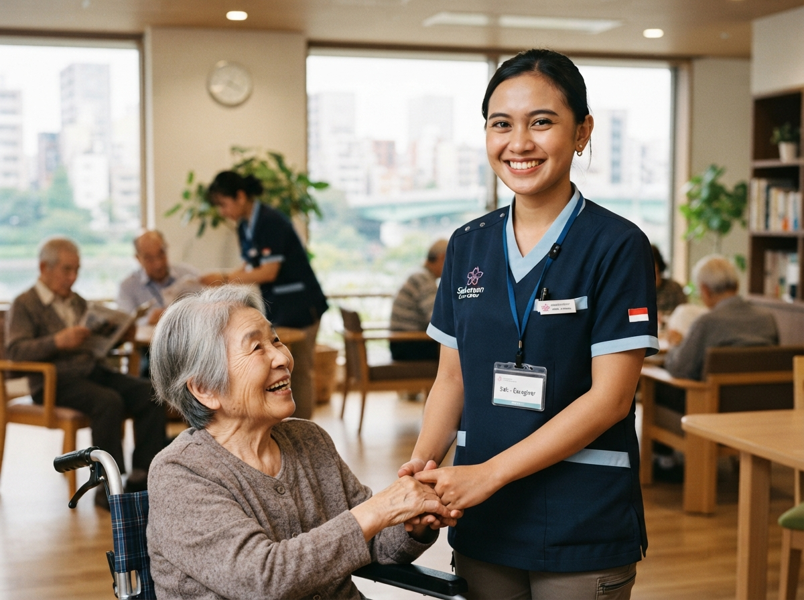

# Design System & UI Specification — LPK Saindo

**Design Direction:** Japanese Corporate Minimalist (和風ミニマリズム)  
**Ethos & Philosophy:** *Shisei* (姿勢 — Integritas, Ketegasan, & Kedisiplinan) dan *Ma* (間 — Ruang Bernapas, Keseimbangan Negatif & Positif)  
**Stitch Reference Project:** `projects/5513990903207659469` (Title: *LPK Saindo - Official Homepage*)  
**Stitch Design System ID:** `assets/c5ca94f2caf448cfae6110a2df4aab70`  
**Visual Preview Asset:** `design_reference/homepage_preview.png`  

---

## 1. Visual Preview & Reference

Desain antarmuka LPK Saindo 2.0 mengadopsi standar visual institusi pendidikan tinggi dan yayasan korporat Jepang. Tampilan bersih, tipografi tegas berjarak rapat pada tajuk, serta aksen merah vermilion (*Shu-iro*) yang digunakan secara terukur seperti stempel segel resmi (*Hanko*).



---

## 2. Color Palette & Design Tokens

Palet warna terinspirasi dari arsitektur kuil Jepang, kertas *washi*, tinta kaligrafi *sumi*, dan gerbang *torii*.

### 2.1 Core Palette

| Token Name | Hex Code | Tailwind Token | Kegunaan |
|---|---|---|---|
| **Japan Vermilion** | `#B91C2C` | `brand-vermilion` | Tombol CTA primer, indikator status aktif, aksen penting |
| **Deep Crimson** | `#991B1B` | `brand-crimson` | Hover state tombol primer, aksen tegas |
| **Sumi Charcoal** | `#171717` | `brand-charcoal` | Teks judul utama, batas struktural, tombol sekunder |
| **Slate Gray** | `#525252` | `brand-slate` | Teks deskripsi paragraf, subtitle, label meta |
| **Muted Stone** | `#737373` | `brand-stone` | Teks keterangan kecil, watermark, border sekunder |
| **Porcelain Canvas** | `#FAFAF8` | `brand-porcelain` | Latar belakang dasar halaman publik (hangat, tidak silau) |
| **Recessed Off-White**| `#F5F4F0` | `brand-offwhite` | Latar section khusus, modul informasi, card inset |
| **Pure White** | `#FFFFFF` | `brand-white` | Permukaan kartu konten, input field, modal container |
| **Hairline Gray** | `#E5E4DE` | `brand-border` | Garis pembatas ultra-halus (1px), pemisah kolom |
| **Warm Sand** | `#ECEAE4` | `brand-sand` | Background chip/badge JLPT, hover state netral |

### 2.2 JLPT & Visa Status Chips

| Kategori | Background | Border | Teks |
|---|---|---|---|
| **JLPT N5** | `#ECFDF5` | `#A7F3D0` | `#065F46` |
| **JLPT N4** | `#F0FDFA` | `#99F6E4` | `#115E59` |
| **JLPT N3** | `#FFFBEB` | `#FDE68A` | `#92400E` |
| **Tokutei Ginou (SSW)**| `#FEF2F2` | `#FECACA` | `#991B1B` |
| **Magang (Jisshuusei)** | `#EEF2FF` | `#C7D2FE` | `#3730A3` |

---

## 3. Typography Hierarchy

Kombinasi tipografi menggunakan font **Manrope** untuk tajuk tegas dan geometris, **Inter** untuk keterbacaan paragraf panjang, dan **Noto Sans JP** untuk rendering teks kanji/kana Jepang yang seimbang.

```
Main Display & Headlines : Manrope (Weights: 500 Medium, 600 SemiBold)
Body Prose & Articles   : Inter (Weights: 400 Regular, 500 Medium)
Japanese Glyphs / Kanji  : Noto Sans JP (Weights: 400 Regular, 500 Medium)
Technical Meta & Badges  : Manrope / Inter (Tracking: 0.04em - 0.08em, Uppercase)
```

### Type Scale Specification

| Role | Font Size | Line Height | Weight | Tracking | Elemen HTML |
|---|---|---|---|---|---|
| **Display LG** | 56px (3.5rem) | 68px | 600 | `-0.03em` | H1 Hero Desktop |
| **Display LG Mobile** | 36px (2.25rem)| 44px | 600 | `-0.02em` | H1 Hero Mobile |
| **Display MD** | 44px (2.75rem) | 54px | 600 | `-0.02em` | Section Titles Terpilih |
| **Headline LG** | 32px (2.0rem)  | 42px | 600 | `-0.015em`| H2 Section Headings |
| **Headline MD** | 24px (1.5rem)  | 32px | 500 | `-0.01em` | H3 Card Titles |
| **Headline SM** | 20px (1.25rem) | 28px | 500 | `-0.005em`| H4 Sub-card Titles |
| **Body LG** | 18px (1.125rem)| 28px | 400 | `0` | Lead Paragraphs / Sub-hero |
| **Body MD** | 15px (0.9375rem)| 24px | 400 | `0` | Standard Body Text |
| **Body SM** | 13px (0.8125rem)| 20px | 400 | `+0.01em` | Captions, Metadata |
| **Label LG** | 14px (0.875rem)| 20px | 500 | `+0.04em` | Tombol CTA, Nav Menu |
| **Label SM** | 11px (0.6875rem)| 14px | 600 | `+0.08em` | JLPT Tags, Section Rubrics |

---

## 4. Grid, Layout & Elevation Principles

### 4.1 Responsive Grid Structure

- **Desktop (≥ 1200px):** 12-Column Asymmetrical Grid, Container Max-Width `1280px`, Horizontal Margin `4rem` (64px), Column Gutter `2.5rem` (40px).
- **Tablet (768px – 1199px):** 8-Column Grid, Horizontal Margin `2.5rem` (40px), Column Gutter `1.5rem` (24px).
- **Mobile (< 768px):** 4-Column Single Flow, Horizontal Margin `1.25rem` (20px), Column Gutter `1rem` (16px).

### 4.2 Elevation & Depth (*Shoji Framing*)

Desain menjauhi efek drop shadow tebal atau gradien plastik. Kedalaman diciptakan murni melalui:
1. **Tonal Stepping:** Dasar halaman `#FAFAF8`, kartu mengambang di atasnya `#FFFFFF`, dan blok informasi khusus `#F5F4F0`.
2. **Hairline Framing:** Batas antar kartu dan section dipisahkan oleh garis tipis `1px solid #E5E4DE`.
3. **Subtle Hover Float:** Pada interaksi kursor, kartu mengangkat halus dengan bayangan difus alami:
   ```css
   box-shadow: 0 12px 32px -8px rgba(23, 23, 23, 0.04), 0 2px 6px -1px rgba(23, 23, 23, 0.02);
   border-color: #171717;
   ```

### 4.3 Corner Radii (Ketegasan Bentuk)

- Kontainer, Kartu, Input Field: `rounded (4px)` — Memberikan kesan presisi teknikal arsitektural.
- Badges, Chips, Pills: `rounded-full (9999px)` — Menciptakan kontras ritmis dengan kontainer kotak.

---

## 5. UI Component Catalog

### 5.1 Buttons
- **Primary Vermilion Button:**
  - Background: `#B91C2C`, Teks: `#FFFFFF`, Radius: `4px`, Padding: `12px 24px`.
  - Hover: Background `#991B1B`. Zero elevation shadow.
- **Secondary Sumi Outline Button:**
  - Background: Transparan, Border: `1px solid #171717`, Teks: `#171717`.
  - Hover: Background `#171717`, Teks: `#FAFAF8`.
- **Tertiary Ghost Button:**
  - Teks `#171717` dengan garis bawah 1px animasi memanjang dari kiri saat hover.

### 5.2 Sticky Header / Navbar
- Latar: `#FAFAF8` dengan opacity `0.9` dan `backdrop-blur: 12px`.
- Border bawah: `1px solid #E5E4DE`.
- Komponen: Logo Saindo di kiri, navigasi 6 menu di tengah, pemilih bahasa `ID | 日本語` dan tombol 'Daftar Sekarang' di kanan.

### 5.3 Curriculum Step Tracker
- Garis monolin horizontal/vertikal menghubungkan lingkaran bernomor `1`, `2`, `3`, `4`, `5`.
- Titik aktif ditandai warna vermilion `#B91C2C` dan garis aktif menghubungkan progres tahapan belajar siswa.

### 5.4 Testimonial & Alumni Card
- Latar: `#FFFFFF`, Border: `1px solid #E5E4DE`.
- Komponen: Foto potret formal/kerja alumni, nama, program keberangkatan, nama prefektur/kota di Jepang, dan kutipan pengalaman.

---

## 6. Homepage Section Layout Specification

```
[01. Sticky Header / Navbar]
------------------------------------------------------------------------
[02. Hero Section]
- Headline: "Masa Depanmu Dimulai dari Sini. Melangkah Bersama Saindo Menuju Jepang."
- Subtitle: "Persiapkan kemampuan bahasa, keterampilan, dan mentalitas untuk membangun karier di Jepang bersama LPK Saindo."
- Dual CTA: [Daftar Sekarang] [Pelajari Program]
- Hero Visual: Siswa LPK Saindo dalam seragam pelatihan & ruang kelas modern.
------------------------------------------------------------------------
[03. Introduction Section]
- Label: TENTANG LEMBAGA / 私たちについて
- Title: "Mempersiapkan Generasi Siap Kerja di Jepang"
- Narrative: Filosofi pelatihan, legalitas, integritas pengajaran.
------------------------------------------------------------------------
[04. Trust Indicators]
- 500+ Alumni Berangkat | 98% Kelulusan JLPT/JFT | 35+ Mitra Kumiai | 8+ Tahun Dedikasi
------------------------------------------------------------------------
[05. Programs Section]
- 4 Cards:
  1. Bahasa Jepang Intensif (N5–N3)
  2. Keterampilan Kerja Spesifik (SSW / Tokutei Ginou)
  3. Bimbingan Wawancara Perusahaan Jepang & COE
  4. Pendidikan Budaya & Etika Kerja Jepang
------------------------------------------------------------------------
[06. Why Saindo?]
- Split layout: Foto fasilitas asrama/lab & daftar keunggulan bersertifikasi.
------------------------------------------------------------------------
[07. Learning Journey]
- 5 Steps Roadmap: Pendaftaran -> Bahasa Jepang -> Pelatihan Skill -> Wawancara -> Terbang ke Jepang.
------------------------------------------------------------------------
[08. Life at Saindo (Gallery Preview)]
- Asymmetric Masonry: 5 Foto dokumentasi kegiatan harian + Tombol [Lihat Semua Galeri].
------------------------------------------------------------------------
[09. Alumni Stories]
- 3 Testimonial Cards alumni yang telah bekerja di Jepang.
------------------------------------------------------------------------
[10. Latest Articles]
- 3 Kartu Berita / Edukasi Blog terkini.
------------------------------------------------------------------------
[11. Consultation CTA Banner]
- "Start Your Journey with Saindo" + WhatsApp Consultation Button.
------------------------------------------------------------------------
[12. Footer]
- Logo, Alamat Kantor, Jam Operasional, No. Izin SO/LPK, Social Links, Copyright.
```
