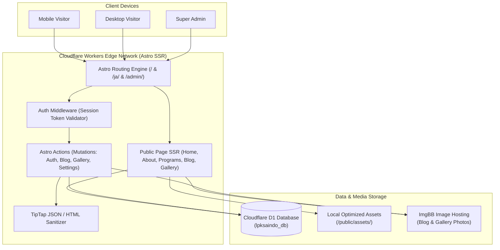

# Implementation Plan — LPK Saindo Website 2.0

**Target Stack:** Astro 5.x (Fullstack SSR) + React (Interactive Islands) + Tailwind CSS + Cloudflare Workers Adapter + Cloudflare D1 + Drizzle ORM + ImgBB API  
**Estimated Iterations:** 8 Phased Milestones  
**Design Reference:** Japanese Corporate Minimalist (Generated & Validated via Stitch MCP: Project `5513990903207659469`)  

---

## Architecture Blueprint

---

## Phase Breakdown & Detailed Work Packages

### Phase 1: Foundation & Project Setup (P0)
**Tujuan:** Membangun fondasi proyek Astro fullstack dengan runtime Cloudflare Workers dan database lokal D1.

- [ ] **1.1 Inisialisasi Proyek Astro:**
  - Setup Astro 5 dengan TypeScript (`strict: true`), Tailwind CSS, dan React integration (`@astrojs/react`).
  - Pasang `@astrojs/cloudflare` adapter dengan mode `server` (SSR).
  - Konfigurasi `astro.config.mjs` untuk output Cloudflare Workers.
- [ ] **1.2 Konfigurasi Cloudflare & Wrangler:**
  - Setup berkas `wrangler.jsonc` dengan binding D1 Database `lpksaindo_db` (local & production database IDs).
  - Setup Worker secrets template untuk `SESSION_SECRET` dan `IMGBB_API_KEY`.
- [ ] **1.3 Konfigurasi Drizzle ORM & Migrasi:**
  - Setup `drizzle-orm` dan `drizzle-kit`.
  - Buat `drizzle.config.ts` yang mengarah ke migration folder `migrations/`.
  - Definisikan initial schema di `src/db/schema.ts`.
  - Eksekusi migrasi lokal via `wrangler d1 migrations apply lpksaindo_db --local`.
- [ ] **1.4 Skrip Otomasi & Environment:**
  - Buat skrip inisialisasi Super Admin: `scripts/create-admin.mjs`.
  - Definisikan types di `src/env.d.ts` untuk Cloudflare runtime binding (`DB: D1Database`, `SESSION_SECRET`, dll).

**Deliverables:**
- Proyek berjalan di localhost via `npm run dev`.
- Build Astro sukses tanpa error: `npm run build`.
- Local D1 database siap menerima query.

---

### Phase 2: Japanese Corporate Design System & Homepage (P0)
**Tujuan:** Mengimplementasikan visual language **Japanese Corporate Minimalist** berpatokan pada referensi Stitch (`5513990903207659469`), membangun komponen dasar, dan merilis Beranda publik 100% responsif.

- [ ] **2.1 Token Styling & Typography:**
  - Impor font `Manrope` (Headings/Display), `Inter` (Body Text), dan `Noto Sans JP` (Aksen & Teks Jepang).
  - Setup palet warna di `tailwind.config.mjs`:
    - Vermilion Red: `#B91C2C`, Deep Vermilion: `#991B1B`.
    - Deep Charcoal: `#171717`, Slate: `#525252`, Stone: `#737373`.
    - Porcelain Canvas: `#FAFAF8`, Off-White: `#F5F4F0`, Clean White: `#FFFFFF`.
    - Hairline Border: `#E5E4DE`, Sand Tint: `#ECEAE4`.
- [ ] **2.2 Core UI Components (`src/components/ui/`):**
  - `Button.astro` (Primary Vermilion, Outline Sumi, Ghost with animated underline).
  - `Badge.astro` (Pill JLPT tags, Visa categories, Status chips).
  - `SectionHeader.astro` (Bilingual label kecil, heading tegas, subline berjarak lega).
  - `Container.astro` (Max-width 1280px dengan margin responsif).
- [ ] **2.3 Layout & Navigasi (`src/components/layout/`):**
  - `Navbar.astro`: Header sticky dengan backdrop blur halus, logo Saindo, navigasi link, toggle bahasa (`ID` / `JA`), dan tombol 'Daftar Sekarang'.
  - `MobileMenu.tsx`: Drawer navigasi mobile yang ringan, accessible, dan mulus.
  - `Footer.astro`: Footer korporat bergaya majalah Jepang dengan legalitas lembaga, kontak, dan tautan sosial.
- [ ] **2.4 Implementasi 12 Section Beranda (`src/components/home/`):**
  1. `HeroSection.astro`: Split editorial dengan headline presisi, dual CTA, dan foto pelatihan.
  2. `IntroSection.astro`: Pernyataan institusi, filosofi *Shisei* & *Ma*, foto kelas.
  3. `TrustMetrics.astro`: 4 metrik kredibilitas (Alumni, Persentase Lulus, Mitra, Pengalaman).
  4. `ProgramsPreview.astro`: 4 kartu jalur program (Bahasa, SSW, Interview, Budaya).
  5. `WhySaindo.astro`: Split layout keunggulan kurikulum & native sensei.
  6. `LearningJourney.astro`: Step tracker 5 tahap dari pendaftaran hingga keberangkatan ke Jepang.
  7. `GalleryPreview.astro`: Masonry grid asimetris kegiatan siswa.
  8. `TestimonialsSection.astro`: Testimoni riil alumni di Jepang dengan kartu editorial.
  9. `LatestNews.astro`: 3 kartu artikel blog terbaru.
  10. `ConsultationCta.astro`: Banner konversi WhatsApp.
- [ ] **2.5 Aset Lokal & Optimasi Gambar:**
  - Tempatkan foto identitas beresolusi tinggi WebP di `public/assets/images/` dan `public/assets/logo/`.

**Deliverables:**
- Halaman beranda desktop & mobile selesai sempurna sesuai spesifikasi Stitch.
- Skor performa Lighthouse > 90 pada mobile dan desktop.

---

### Phase 3: Public Modular Pages & Bilingual Routing (P1)
**Tujuan:** Membangun seluruh halaman sekunder publik dan mengaktifkan routing bilingual Indonesia & Jepang.

- [ ] **3.1 Halaman Tentang Kami (`/about` & `/ja/about`):**
  - Visi, misi, sejarah, profil pimpinan & sensei, galeri fasilitas sarana prasarana.
- [ ] **3.2 Halaman Program Pelatihan (`/programs` & `/programs/[slug]`):**
  - Detail kurikulum Bahasa Jepang N5–N3, Tokutei Ginou SSW, pembekalan budaya.
- [ ] **3.3 Halaman Galeri Dokumentasi (`/gallery` & `/gallery/[slug]`):**
  - Daftar album kegiatan + detail album dengan interaksi lightbox foto (`React` island).
- [ ] **3.4 Halaman Blog / Berita (`/blog` & `/blog/[slug]`):**
  - Listing artikel dengan pagination dan filter kategori.
  - Detail artikel lengkap dengan TipTap JSON renderer, breadcrumbs, dan waktu baca.
- [ ] **3.5 Halaman Kontak (`/contact` & `/ja/contact`):**
  - Alamat operasional, peta interaktif, formulir kontak cepat & WhatsApp gateway.
- [ ] **3.6 Infrastruktur i18n (`src/i18n/`):**
  - Kamus terjemahan antarmuka `id.json` dan `ja.json`.
  - Helper fungsi `useTranslations(lang)`.
  - Fallback aman jika konten dinamis Jepang belum diterjemahkan.

---

### Phase 4: Single-Admin Authentication & CMS Core (P1)
**Tujuan:** Mengamankan area manajemen internal dengan sistem autentikasi mandiri berbasis Cloudflare D1.

- [ ] **4.1 Skrip Setup Super Admin:**
  - `node scripts/create-admin.mjs` untuk generate password hash dan inject admin pertama ke D1.
- [ ] **4.2 Logika Autentikasi & Session:**
  - Endpoint / Astro Action Login: verifikasi email + password hash.
  - Pembuatan cryptographically secure random session token.
  - Simpan token hash di tabel `sessions`.
  - Set Cookie `saindo_session` dengan flags: `HttpOnly; Secure; SameSite=Strict; Path=/; Max-Age=604800`.
- [ ] **4.3 Auth Middleware (`src/middleware.ts`):**
  - Interseptor semua rute `/admin/*` (kecuali `/admin/login`).
  - Validasi keberadaan session di D1; jika invalid/expired, redirect ke `/admin/login`.
  - Inject data user ke `Astro.locals.user`.
- [ ] **4.4 Dashboard Overview (`/admin/dashboard`):**
  - Ringkasan total artikel, artikel terbit, album foto, dan pengaturan status sistem.

---

### Phase 5: TipTap Blog CMS (P1)
**Tujuan:** Memberikan admin antarmuka rich-text modern untuk mempublikasikan artikel bilingual.

- [ ] **5.1 Integrasi TipTap Rich Text Editor (`RichTextEditor.tsx`):**
  - React island editor dengan toolbar minimalis (Bold, Italic, Headings, Bullet List, Ordered List, Image, Quote, Link).
  - Output konten dalam format TipTap JSON murni.
- [ ] **5.2 Form Manajemen Artikel:**
  - Pengisian judul Indonesia & Jepang, auto-slug generator, ringkasan (excerpt).
  - Pemilihan cover image dari Media Library.
  - Pilihan kategori dan tag dinamis.
  - Tab konfigurasi SEO metadata (SEO Title, Meta Description).
- [ ] **5.3 Astro Actions untuk Mutasi Blog:**
  - `createPost`, `updatePost`, `deletePost`, `togglePublishStatus`.
  - Validasi Zod schema server-side.

---

### Phase 6: Gallery CMS & ImgBB Media Bridge (P1)
**Tujuan:** Memfasilitasi pengelolaan dokumentasi visual berkapasitas besar menggunakan Cloudflare D1 + ImgBB API.

- [ ] **6.1 Integrasi ImgBB API Server-Side:**
  - Astro Action menerima file stream `multipart/form-data`.
  - Validasi server-side: format file (JPEG, PNG, WebP), ukuran maksimal (8MB).
  - Forward binary stream ke ImgBB Upload API menggunakan `IMGBB_API_KEY`.
  - Ambil direct URL, thumbnail URL, dan delete hash.
- [ ] **6.2 Media Library (`/admin/media`):**
  - Tampilan grid semua gambar yang pernah diunggah.
  - Pencarian berdasarkan nama berkas dan alt text.
  - Mekanisme proteksi hapus (cek referensi berkas di tabel `posts` dan `gallery_items`).
- [ ] **6.3 Album & Gallery Item Manager:**
  - Buat album baru, atur urutan (*drag and drop* atau numeric index).
  - Tambahkan banyak foto sekaligus ke album, lengkapi caption dan alt text.

---

### Phase 7: Website Configuration & SEO Settings (P2)
**Tujuan:** Konfigurasi identitas lembaga dan kontak tanpa edit kode sumber.

- [ ] **7.1 Settings Dashboard (`/admin/settings`):**
  - Form pengubahan nomor WhatsApp, email kontak, alamat, tautan media sosial.
  - Konfigurasi default fallback meta title dan description.
- [ ] **7.2 Penyimpanan Key-Value di D1 (`settings` table):**
  - Helper query berkinerja tinggi untuk memuat setting ke halaman publik saat SSR.
- [ ] **7.3 SEO & Structured Data:**
  - Dynamic `sitemap.xml` dan `robots.txt` endpoints.
  - JSON-LD structured data untuk profil lembaga pendidikan (*EducationalOrganization*).

---

### Phase 8: Quality Assurance, Testing & Deployment (P2)
**Tujuan:** Finalisasi pengujian menyeluruh dan peluncuran ke Cloudflare Workers.

- [ ] **8.1 Pengujian Responsif & Lintas Perangkat:**
  - Uji tampilan pada viewport Mobile (iPhone, Android 375px–412px), Tablet (768px–1024px), dan Desktop (>1280px).
- [ ] **8.2 Security & Penetration Checklist:**
  - Pastikan halaman `/admin` tidak bocor tanpa session valid.
  - Pastikan draft blog tidak bisa diakses dari URL publik.
  - Pastikan API Key ImgBB tidak bocor ke client-side bundle.
- [ ] **8.3 Production Deployment:**
  - Buat database Cloudflare D1 production via Cloudflare Dashboard / Wrangler CLI.
  - Jalankan migrasi schema production: `wrangler d1 migrations apply lpksaindo_db --remote`.
  - Set Worker secrets di Cloudflare: `wrangler secret put SESSION_SECRET` & `wrangler secret put IMGBB_API_KEY`.
  - Eksekusi deploy: `wrangler deploy`.

---

## Risk Assessment & Mitigation Matrix

| Risiko Potensial | Dampak | Probabilitas | Strategi Mitigasi |
|---|---|---|---|
| **Limit Kuota / Latensi ImgBB API** | Sedang | Rendah | Aset identitas utama (hero, logo, fasilitas) disimpan lokal di `/public/assets/`. ImgBB hanya untuk konten dinamis blog/galeri. Sediakan fallback thumbnail. |
| **Bilingual Gap (Konten Jepang Belum Lengkap)** | Rendah | Sedang | Terapkan aturan fallback elegan: bila artikel/album belum memiliki versi Jepang, tampilkan badge ramah *"Bahasa Indonesiaのみ提供"* dan tautan ke artikel ID. |
| **Ukuran Bundle Worker Cloudflare** | Tinggi | Rendah | Astro mem-bundle halaman statis ke HTML statis di edge asset store; hanya rute dinamis dan Actions yang memicu worker runtime. Total bundle sangat ringan (<1MB). |
| **Konektivitas D1 saat Cold Start** | Rendah | Sangat Rendah | D1 adalah native storage Cloudflare terintegrasi langsung dalam runtime V8 Worker yang sama, tanpa overhead TCP connection pooling. |
