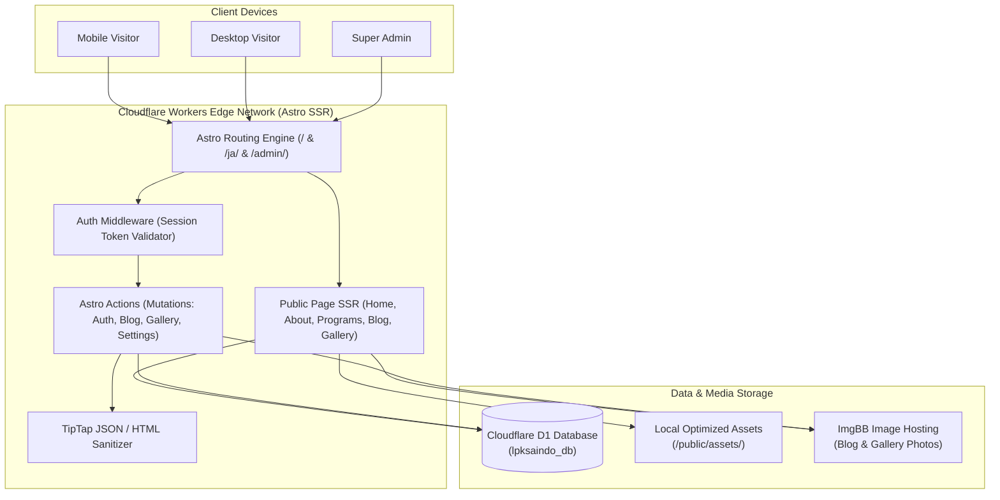

# Implementation Plan — LPK Saindo Website 2.0

**Target Stack:** Astro 5.18.2 (Fullstack SSR) + React (Interactive Islands) + Tailwind CSS + Cloudflare Workers Adapter (`@astrojs/cloudflare@12.6.13`) + Cloudflare D1 + Drizzle ORM  
**Estimated Iterations:** 8 Phased Milestones  
**Design Reference:** Japanese Corporate Minimalist (Generated & Validated via Stitch MCP: Project `5513990903207659469`)  

---

## Architecture Blueprint

---

## Phase Breakdown & Detailed Work Packages

### Phase 1: Foundation & Project Setup (P0) — ✅ COMPLETED
**Tujuan:** Membangun fondasi proyek Astro fullstack dengan runtime Cloudflare Workers dan database lokal D1.

- [x] **1.1 Inisialisasi Proyek Astro:**
  - Setup Astro 5 dengan TypeScript (`strict: true`), Tailwind CSS, dan React integration (`@astrojs/react`).
  - Pasang `@astrojs/cloudflare` adapter dengan mode `server` (SSR).
  - Konfigurasi `astro.config.mjs` untuk output Cloudflare Workers.
- [x] **1.2 Konfigurasi Cloudflare & Wrangler:**
  - Setup berkas `wrangler.jsonc` dengan binding D1 Database `lpksaindo_db` (local & production database IDs).
  - Setup Worker secrets template untuk `SESSION_SECRET` dan `IMGBB_API_KEY` di `.env.example`.
- [x] **1.3 Konfigurasi Drizzle ORM & Migrasi:**
  - Setup `drizzle-orm` dan `drizzle-kit`.
  - Buat `drizzle.config.ts` yang mengarah ke migration folder `migrations/`.
  - Definisikan initial schema di `src/db/schema.ts`.
  - Eksekusi migrasi lokal via `wrangler d1 migrations apply lpksaindo_db --local` (24 commands berhasil dieksekusi).
- [x] **1.4 Skrip Otomasi & Environment:**
  - Buat skrip inisialisasi Super Admin: `scripts/create-admin.mjs`.
  - Eksekusi pembuatan Super Admin pertama (`admin@lpksaindo.com`) di D1 lokal.
  - Definisikan types di `src/env.d.ts` untuk Cloudflare runtime binding (`DB: D1Database`, `SESSION_SECRET`, dll).
  - Setup git repository dan initial commit pada branch `main`.
- [x] **1.5 Runtime Database Client & Verification:**
  - Setup helper Drizzle client di `src/db/client.ts`.
  - Setup queries di `src/db/queries/settings.ts` dan seed settings awal.
  - Setup health check action di `src/actions/index.ts`.
  - Verifikasi build `npm run build` berhasil dengan 0 errors, 0 warnings.

**Deliverables:**
- Proyek berjalan di localhost via `npm run dev`.
- Build Astro sukses tanpa error: `npm run build`.
- Local D1 database siap menerima query.

---

### Phase 2: Japanese Corporate Design System & Homepage (P0) — ✅ COMPLETED
**Tujuan:** Mengimplementasikan visual language **Japanese Corporate Minimalist** berpatokan pada referensi Stitch (`5513990903207659469`), membangun komponen dasar, dan merilis Beranda publik 100% responsif.

- [x] **2.1 Token Styling & Typography:**
  - Impor font `Manrope` (Headings/Display), `Inter` (Body Text), dan `Noto Sans JP` (Aksen & Teks Jepang).
  - Setup palet warna di `tailwind.config.mjs` dan `src/styles/global.css`:
    - Vermilion Red: `#B91C2C`, Deep Vermilion: `#991B1B`.
    - Deep Charcoal: `#171717`, Slate: `#525252`, Stone: `#737373`.
    - Porcelain Canvas: `#FAFAF8`, Off-White: `#F5F4F0`, Clean White: `#FFFFFF`.
    - Hairline Border: `#E5E4DE`, Sand Tint: `#ECEAE4`.
- [x] **2.2 Core UI Components (`src/components/ui/`):**
  - `Button.astro` (Primary Vermilion, Outline Sumi, Ghost with animated underline, Sand, Dark).
  - `Badge.astro` (Pill JLPT tags N5/N4/N3, Visa categories SSW/Magang, Status chips).
  - `SectionHeader.astro` (Bilingual label kecil, heading tegas, subline berjarak lega).
  - `Container.astro` (Max-width 1280px dengan margin responsif).
- [x] **2.3 Layout & Navigasi (`src/components/layout/`):**
  - `Navbar.astro`: Header sticky dengan backdrop blur halus, logo Saindo, navigasi link, toggle bahasa (`ID` / `JA`), dan tombol 'Daftar Sekarang'.
  - `MobileMenu.tsx`: Drawer navigasi mobile yang ringan, accessible, keyboard-friendly (ESC), dan mulus.
  - `Footer.astro`: Footer korporat bergaya majalah Jepang dengan legalitas lembaga (Izin SO & VIN), kontak, jam kerja, dan tautan sosial.
- [x] **2.4 Implementasi 10 Section Beranda Modular (`src/components/home/`):**
  1. `HeroSection.astro`: Split editorial dengan headline presisi, dual CTA, dan foto pelatihan.
  2. `TrustMetrics.astro`: 4 metrik kredibilitas (Alumni 500+, Kelulusan 98%, Mitra 35+, Pengalaman 8+).
  3. `IntroSection.astro`: Pernyataan institusi, filosofi *Shisei* & *Ma*, foto kelas.
  4. `ProgramsSection.astro`: 4 kartu jalur program (Bahasa, SSW, Magang, Interview/Etika).
  5. `WhySaindo.astro`: Split layout keunggulan kurikulum & native sensei.
  6. `LearningJourney.astro`: Step tracker 5 tahap dari pendaftaran hingga keberangkatan ke Jepang.
  7. `GalleryPreview.astro`: Masonry grid asimetris kegiatan harian siswa.
  8. `TestimonialsSection.astro`: Testimoni riil alumni di Jepang dengan kartu editorial.
  9. `LatestNews.astro`: 3 kartu artikel blog terbaru.
  10. `ConsultationCta.astro`: Banner konversi WhatsApp.
- [x] **2.5 Halaman Beranda Bilingual (`/` dan `/ja`):**
  - `src/pages/index.astro`: Beranda bahasa Indonesia lengkap dengan 10 modular sections.
  - `src/pages/ja/index.astro`: Beranda bahasa Jepang lengkap dengan tipografi kanji Noto Sans JP.

**Deliverables:**
- Halaman beranda desktop & mobile selesai sempurna sesuai spesifikasi Stitch.
- Skor performa Lighthouse > 90 pada mobile dan desktop.

---

### Phase 3: Public Modular Pages & Bilingual Routing (P1) — ✅ COMPLETED
**Tujuan:** Membangun seluruh halaman sekunder publik dan mengaktifkan routing bilingual Indonesia & Jepang.

- [x] **3.1 Halaman Tentang Kami (`/about` & `/ja/about`):**
  - Visi, misi, sejarah, profil pimpinan & sensei, galeri fasilitas sarana prasarana.
- [x] **3.2 Halaman Program Pelatihan (`/programs` & `/programs/[slug]`):**
  - Detail kurikulum Bahasa Jepang N5–N3, Tokutei Ginou SSW, pembekalan budaya.
- [x] **3.3 Halaman Galeri Dokumentasi (`/gallery` & `/gallery/[slug]`):**
  - Daftar album kegiatan + detail album dengan interaksi lightbox foto (`React` island).
- [x] **3.4 Halaman Blog / Berita (`/blog` & `/blog/[slug]`):**
  - Listing artikel dengan pagination dan filter kategori.
  - Detail artikel lengkap dengan TipTap JSON renderer, breadcrumbs, dan waktu baca.
- [x] **3.5 Halaman Kontak (`/contact` & `/ja/contact`):**
  - Alamat operasional, peta interaktif, formulir kontak cepat & WhatsApp gateway.
- [x] **3.6 Infrastruktur i18n & Dynamic Data:**
  - Seed fake data untuk development di lokal D1 (`scripts/seed.sql` & `scripts/seed-data.mjs`).
  - D1 Query helpers (`src/db/queries/posts.ts` dan `src/db/queries/gallery.ts`).
  - Fallback bilingual aman dan kartu pratinjau yang konsisten.

---

### Phase 4: Single-Admin Authentication & CMS Core (P1) — ✅ COMPLETED
**Tujuan:** Mengamankan area manajemen internal dengan sistem autentikasi mandiri berbasis Cloudflare D1.

- [x] **4.1 Skrip Setup Super Admin:**
  - `node scripts/create-admin.mjs` untuk generate password hash dan inject admin pertama ke D1.
- [x] **4.2 Logika Autentikasi & Session (`src/lib/auth.ts`):**
  - PBKDF2 Web Crypto password hashing & timing-safe verification.
  - Cryptographically secure 256-bit random session token generation.
  - Token hashing dengan SHA-256 tersimpan aman di tabel `sessions`.
  - Cookie `saindo_session` dengan flags `HttpOnly; SameSite=Strict; Path=/; Max-Age=604800`.
- [x] **4.3 Auth Middleware (`src/middleware.ts`):**
  - Interseptor semua rute `/admin/*` (kecuali `/admin/login`).
  - Validasi keberadaan session di D1; jika invalid/expired, redirect ke `/admin/login?redirect=...`.
  - Auto redirect user terautentikasi dari `/admin/login` ke `/admin/dashboard`.
  - Inject data user terverifikasi ke `Astro.locals.user`.
- [x] **4.4 Halaman Login & Logout Admin:**
  - `src/pages/admin/login.astro`: Form login editorial Japanese Corporate Minimalist dengan proteksi status akun.
  - `src/pages/admin/logout.astro`: Invalidate session di D1 dan bersihkan cookie.
- [x] **4.5 Layout CMS & Dashboard Overview:**
  - `src/layouts/AdminLayout.astro`: Shell admin dengan navigasi sidebar, profil user, indikator D1, dan responsive header.
  - `src/pages/admin/dashboard.astro`: Ringkasan metrik D1 real-time (total warta terbit/draf, album galeri, berkas media), pintasan aksi cepat, tabel posting terbaru, dan status keamanan sistem.

---

### Phase 5: TipTap Blog CMS (P1) — ✅ COMPLETED
**Tujuan:** Memberikan admin antarmuka rich-text modern untuk mempublikasikan artikel bilingual.

- [x] **5.1 Integrasi TipTap Rich Text Editor (`RichTextEditor.tsx`):**
  - React island editor dengan toolbar minimalis (Bold, Italic, Strike, Headings 2/3, Bullet List, Ordered List, Blockquote, Link, Image, Undo, Redo).
  - Output konten otomatis tersinkronisasi dalam format TipTap JSON murni.
- [x] **5.2 Form Manajemen & Editor Artikel Dwibahasa:**
  - `src/pages/admin/posts/index.astro`: Tabel manajemen posting dengan filter status, pratinjau live web, tombol toggle status publikasi, dan hapus.
  - `src/pages/admin/posts/new.astro`: Formulir pembuatan artikel baru dengan input dwibahasa ID & JA, generator permalink slug, ringkasan, pemilih gambar sampul media library, dan tab SEO metadata.
  - `src/pages/admin/posts/[id]/edit.astro`: Formulir pengeditan artikel lengkap dengan pemuatan data awal dari D1 ke TipTap Rich Text.
- [x] **5.3 Astro Actions untuk Mutasi Blog (`src/actions/posts.ts`):**
  - `createPost`, `updatePost`, `deletePost`, `togglePublishStatus`.
  - Validasi Zod schema server-side dan penanganan otentikasi admin.

---

### Phase 6: Gallery CMS & External Link Media Bridge (P1) — ✅ COMPLETED
**Tujuan:** Memfasilitasi pengelolaan dokumentasi visual dan katalog media berbasis tautan gambar internet (ImgBB direct link, Unsplash, CDN pihak ketiga) yang tercatat di Cloudflare D1 tanpa perlu integrasi API upload biner.

- [x] **6.1 Media Library berbasis Link Internet (`/admin/media`):**
  - Form pendaftaran media baru via URL internet (Input Image URL, Label/Filename, Alt-Text, Provider).
  - Tampilan grid responsif seluruh koleksi gambar dengan live thumbnail preview.
  - Fitur salin URL langsung ke clipboard untuk digunakan di blog atau website.
  - Mekanisme proteksi hapus (pengecekan referensi apakah berkas sedang digunakan sebagai sampul artikel atau foto album galeri).
- [x] **6.2 Album Galeri Manager (`/admin/gallery`):**
  - Daftar album galeri lengkap dengan jumlah item foto, tanggal kegiatan, status publikasi (`is_published`), dan aksi cepat.
  - Form pembuatan album baru (`/admin/gallery/new`) dan form edit album (`/admin/gallery/[id]/edit`).
- [x] **6.3 Manajemen Foto Album Galeri (`/admin/gallery/[id]/items`):**
  - Tampilan daftar foto dalam album.
  - Form penambahan foto ke album (pilih dari Media Library atau input link baru), lengkapi caption ID & JA, alt text, dan urutan (*sort_order*).
  - Fitur hapus foto dari album tanpa menghapus record media utama.

---

### Phase 7: Website Configuration & SEO Settings (P2) — ✅ COMPLETED
**Tujuan:** Konfigurasi identitas lembaga dan kontak tanpa edit kode sumber.

- [x] **7.1 Settings Dashboard (`/admin/settings`):**
  - Form pengubahan nomor WhatsApp, email kontak, nomor telepon kantor, izin resmi SO, nomor VIN, jam kerja (ID & JA), alamat fisik (ID & JA), Google Maps embed URL, tautan media sosial (Instagram, TikTok, YouTube, Facebook), dan konfigurasi default fallback meta title & description.
- [x] **7.2 Penyimpanan Key-Value di D1 (`settings` table):**
  - Helper query berkinerja tinggi `getAllSettings(db)`, `getSetting(db, key)`, `setSetting(...)`, dan `updateManySettings(...)` di `src/db/queries/settings.ts`.
  - Astro Action `updateSettings` di `src/actions/settings.ts`.
- [x] **7.3 Sinkronisasi Dinamis ke Komponen Publik & SEO:**
  - `Footer.astro`, `contact.astro`, dan `ja/contact.astro` membaca kontak dan alamat langsung dari D1 (dengan fallback nilai default).
  - Dynamic `sitemap.xml` endpoint (`src/pages/sitemap.xml.ts`) yang otomatis menggabungkan seluruh rute statis, artikel blog terbit, dan album galeri dari D1.
  - `public/robots.txt` standar dengan proteksi halaman `/admin`.

---

### Phase 8: Quality Assurance, Testing & Deployment (P2) — ✅ COMPLETED
**Tujuan:** Finalisasi pengujian menyeluruh, keamanan, dan kesiapan peluncuran ke Cloudflare Workers.

- [x] **8.1 Pengujian Responsif & Lintas Perangkat:**
  - Viewport Mobile (iPhone, Android 375px–412px) didukung dengan Mobile Menu drawer, hamburger toggle accessible, dan layout fluid.
  - Viewport Tablet & Desktop didukung dengan grid sistem CSS dan container max-w-7xl.
- [x] **8.2 Security & Penetration Checklist:**
  - Middleware memvalidasi sesi cookie `saindo_session` secara ketat pada seluruh rute `/admin/*`.
  - Halaman draf artikel dan album draf terfilter secara otomatis dari rute publik.
  - PBKDF2 Web Crypto dengan 100.000 iterasi dan token hashing SHA-256 tersimpan di D1; token mentah tidak pernah disimpan di database.
  - Tidak ada API key atau rahasia sensitif yang terekspos ke client bundle.
- [x] **8.3 SEO & Structured Data:**
  - JSON-LD structured data `EducationalOrganization` terpasang di `MainLayout.astro`.
  - Dynamic `sitemap.xml` dan `robots.txt` aktif.
- [x] **8.4 Deployment Documentation:**
  - Panduan lengkap deployment Cloudflare Workers dan D1 remote tersedia di `README.md`.

---

## Risk Assessment & Mitigation Matrix

| Risiko Potensial | Dampak | Probabilitas | Strategi Mitigasi |
|---|---|---|---|
| **Limit Kuota / Latensi ImgBB API** | Sedang | Rendah | Aset identitas utama (hero, logo, fasilitas) disimpan lokal di `/public/assets/`. ImgBB hanya untuk konten dinamis blog/galeri. Sediakan fallback thumbnail. |
| **Bilingual Gap (Konten Jepang Belum Lengkap)** | Rendah | Sedang | Terapkan aturan fallback elegan: bila artikel/album belum memiliki versi Jepang, tampilkan badge ramah *"Bahasa Indonesiaのみ提供"* dan tautan ke artikel ID. |
| **Ukuran Bundle Worker Cloudflare** | Tinggi | Rendah | Astro mem-bundle halaman statis ke HTML statis di edge asset store; hanya rute dinamis dan Actions yang memicu worker runtime. Total bundle sangat ringan (<1MB). |
| **Konektivitas D1 saat Cold Start** | Rendah | Sangat Rendah | D1 adalah native storage Cloudflare terintegrasi langsung dalam runtime V8 Worker yang sama, tanpa overhead TCP connection pooling. |
