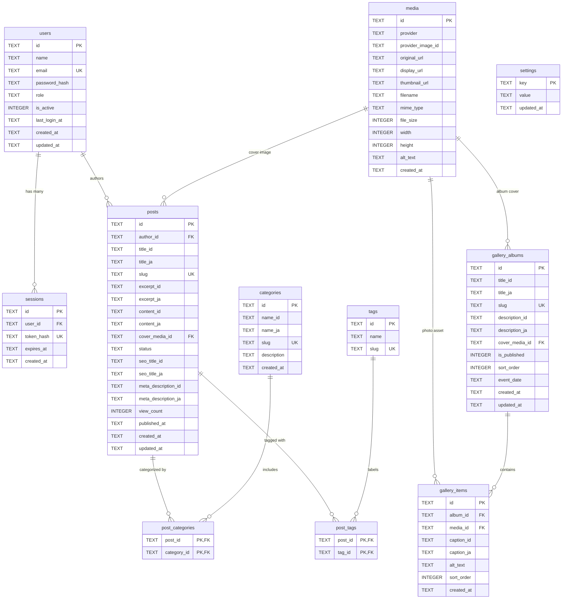

# Database Schema & Technical Architecture — LPK Saindo 2.0

**Database Engine:** Cloudflare D1 (Serverless SQLite at the Edge)  
**Database Name:** `lpksaindo_db`  
**ORM / Query Builder:** Drizzle ORM + D1 Prepared Statements  
**Primary Key Standard:** UUID v4 (Stored as `TEXT`)  
**Timestamp Standard:** UTC ISO 8601 (`YYYY-MM-DDTHH:MM:SS.SSSZ`)  

---

## 1. Entity-Relationship Diagram (ERD)



---

## 2. Table Specifications & Data Dictionaries

### 2.1 Table: `users`
Menyimpan akun Super Admin pengelola website.
| Kolom | Tipe | Nullable | Default | Keterangan |
|---|---|---|---|---|
| `id` | TEXT | NO | - | Primary Key (UUID v4) |
| `name` | TEXT | NO | - | Nama lengkap admin |
| `email` | TEXT | NO | - | Email unik untuk login |
| `password_hash` | TEXT | NO | - | Hash password (PBKDF2/WebCrypto) |
| `role` | TEXT | NO | 'super_admin' | Hak akses (super_admin) |
| `is_active` | INTEGER | NO | 1 | 1 = Aktif, 0 = Nonaktif |
| `last_login_at` | TEXT | YES | NULL | Waktu login terakhir (ISO 8601) |
| `created_at` | TEXT | NO | (current_timestamp) | Waktu pendaftaran |
| `updated_at` | TEXT | NO | (current_timestamp) | Waktu modifikasi terakhir |

### 2.2 Table: `sessions`
Menyimpan sesi login aktif administrator.
| Kolom | Tipe | Nullable | Default | Keterangan |
|---|---|---|---|---|
| `id` | TEXT | NO | - | Primary Key (UUID v4) |
| `user_id` | TEXT | NO | - | Foreign Key -> `users(id)` ON DELETE CASCADE |
| `token_hash` | TEXT | NO | - | Hash SHA-256 dari session token cookie |
| `expires_at` | TEXT | NO | - | Waktu kedaluwarsa sesi (ISO 8601) |
| `created_at` | TEXT | NO | (current_timestamp) | Waktu inisiasi sesi |

### 2.3 Table: `posts`
Menyimpan konten artikel berita, pengumuman, dan materi edukasi.
| Kolom | Tipe | Nullable | Default | Keterangan |
|---|---|---|---|---|
| `id` | TEXT | NO | - | Primary Key (UUID v4) |
| `author_id` | TEXT | NO | - | Foreign Key -> `users(id)` |
| `title_id` | TEXT | NO | - | Judul artikel bahasa Indonesia |
| `title_ja` | TEXT | YES | NULL | Judul artikel bahasa Jepang |
| `slug` | TEXT | NO | - | URL slug unik (contoh: `lulus-jft-basic-a2`) |
| `excerpt_id` | TEXT | NO | - | Ringkasan singkat bahasa Indonesia |
| `excerpt_ja` | TEXT | YES | NULL | Ringkasan singkat bahasa Jepang |
| `content_id` | TEXT | NO | - | Konten artikel bahasa Indonesia (TipTap JSON) |
| `content_ja` | TEXT | YES | NULL | Konten artikel bahasa Jepang (TipTap JSON) |
| `cover_media_id` | TEXT | YES | NULL | Foreign Key -> `media(id)` ON DELETE SET NULL |
| `status` | TEXT | NO | 'draft' | Status tayang: `'draft'` atau `'published'` |
| `seo_title_id` | TEXT | YES | NULL | Judul SEO (ID) |
| `seo_title_ja` | TEXT | YES | NULL | Judul SEO (JA) |
| `meta_description_id` | TEXT | YES | NULL | Deskripsi meta (ID) |
| `meta_description_ja` | TEXT | YES | NULL | Deskripsi meta (JA) |
| `view_count` | INTEGER | NO | 0 | Jumlah total views artikel |
| `published_at` | TEXT | YES | NULL | Waktu publikasi (ISO 8601) |
| `created_at` | TEXT | NO | (current_timestamp) | Waktu dibuat |
| `updated_at` | TEXT | NO | (current_timestamp) | Waktu diubah |

### 2.4 Table: `categories` & `post_categories`
Kategori blog dan relasi many-to-many dengan posts.
| Kolom | Tipe | Nullable | Keterangan |
|---|---|---|---|
| `categories.id` | TEXT | NO | Primary Key (UUID v4) |
| `categories.name_id` | TEXT | NO | Nama kategori ID (e.g. *Informasi Magang*) |
| `categories.name_ja` | TEXT | YES | Nama kategori JA (e.g. *実習生情報*) |
| `categories.slug` | TEXT | NO | Slug kategori unik (e.g. `informasi-magang`) |
| `categories.description` | TEXT | YES | Keterangan kategori |
| `categories.created_at` | TEXT | NO | Timestamp |
| `post_categories.post_id` | TEXT | NO | FK -> `posts(id)` ON DELETE CASCADE |
| `post_categories.category_id` | TEXT | NO | FK -> `categories(id)` ON DELETE CASCADE |

### 2.5 Table: `tags` & `post_tags`
Tag kata kunci blog dan relasi many-to-many.
| Kolom | Tipe | Nullable | Keterangan |
|---|---|---|---|
| `tags.id` | TEXT | NO | Primary Key (UUID v4) |
| `tags.name` | TEXT | NO | Nama tag (e.g. `JLPT`, `Tokutei Ginou`) |
| `tags.slug` | TEXT | NO | Slug tag unik |
| `post_tags.post_id` | TEXT | NO | FK -> `posts(id)` ON DELETE CASCADE |
| `post_tags.tag_id` | TEXT | NO | FK -> `tags(id)` ON DELETE CASCADE |

### 2.6 Table: `media`
Metadata berkas visual yang ditautkan melalui link internet eksternal (ImgBB direct link, Unsplash, CDN).
| Kolom | Tipe | Nullable | Keterangan |
|---|---|---|---|
| `id` | TEXT | NO | Primary Key (UUID v4) |
| `provider` | TEXT | NO | Penyedia gambar: `'external_link'`, `'imgbb'`, atau `'unsplash'` |
| `provider_image_id`| TEXT | YES | ID gambar eksternal opsional |
| `original_url` | TEXT | NO | URL gambar resolusi asli dari internet |
| `display_url` | TEXT | NO | URL optimal untuk rendering tampilan |
| `thumbnail_url` | TEXT | YES | URL thumbnail ringkas |
| `filename` | TEXT | NO | Nama berkas / label deskriptif |
| `mime_type` | TEXT | NO | e.g. `image/jpeg`, `image/webp` |
| `file_size` | INTEGER| NO | Ukuran berkas dalam bytes (default 0 jika via URL) |
| `width` | INTEGER| YES | Lebar piksel gambar opsional |
| `height` | INTEGER| YES | Tinggi piksel gambar opsional |
| `alt_text` | TEXT | YES | Alt-text aksesibilitas & SEO |
| `created_at` | TEXT | NO | Timestamp pencatatan tautan |

### 2.7 Table: `gallery_albums` & `gallery_items`
Dokumentasi album foto dan foto per kegiatan.
| Kolom | Tipe | Nullable | Keterangan |
|---|---|---|---|
| `gallery_albums.id` | TEXT | NO | Primary Key (UUID v4) |
| `gallery_albums.title_id` | TEXT | NO | Judul album ID |
| `gallery_albums.title_ja` | TEXT | YES | Judul album JA |
| `gallery_albums.slug` | TEXT | NO | Slug album unik |
| `gallery_albums.description_id` | TEXT | YES | Keterangan album ID |
| `gallery_albums.description_ja` | TEXT | YES | Keterangan album JA |
| `gallery_albums.cover_media_id` | TEXT | YES | FK -> `media(id)` ON DELETE SET NULL |
| `gallery_albums.is_published` | INTEGER | NO | 1 = Tampil, 0 = Sembunyi |
| `gallery_albums.sort_order` | INTEGER | NO | Urutan tampilan (default: 0) |
| `gallery_albums.event_date` | TEXT | YES | Tanggal kegiatan diselenggarakan |
| `gallery_albums.created_at` | TEXT | NO | Timestamp pembuatan |
| `gallery_albums.updated_at` | TEXT | NO | Timestamp perubahan |
| `gallery_items.id` | TEXT | NO | Primary Key (UUID v4) |
| `gallery_items.album_id` | TEXT | NO | FK -> `gallery_albums(id)` ON DELETE CASCADE |
| `gallery_items.media_id` | TEXT | NO | FK -> `media(id)` ON DELETE RESTRICT |
| `gallery_items.caption_id` | TEXT | YES | Keterangan foto ID |
| `gallery_items.caption_ja` | TEXT | YES | Keterangan foto JA |
| `gallery_items.alt_text` | TEXT | YES | Aksesibilitas alt text |
| `gallery_items.sort_order` | INTEGER | NO | Urutan foto dalam album |
| `gallery_items.created_at` | TEXT | NO | Timestamp |

### 2.8 Table: `settings`
Konfigurasi key-value untuk identitas lembaga, kontak, dan SEO default.
| Kolom | Tipe | Nullable | Keterangan |
|---|---|---|---|
| `key` | TEXT | NO | Primary Key (e.g. `whatsapp_number`, `site_name`) |
| `value` | TEXT | NO | Nilai setting (JSON string atau string teks) |
| `updated_at` | TEXT | NO | Waktu modifikasi terakhir |

Daftar Key Standar:
- `site_name`: "LPK Saindo"
- `tagline_id`: "Masa Depanmu Dimulai dari Sini. Melangkah Bersama Saindo Menuju Jepang."
- `tagline_ja`: "あなたの未来はここから始まる。Saindoと共に日本へ。"
- `whatsapp_number`: "628123456789"
- `contact_email`: "info@lpksaindo.com"
- `address_id`: "Jl. Raya Saindo No. 8, Indonesia"
- `address_ja`: "インドネシア共和国..."
- `instagram_url`: "https://instagram.com/lpksaindo"
- `facebook_url`: "https://facebook.com/lpksaindo"
- `youtube_url`: "https://youtube.com/@lpksaindo"
- `tiktok_url`: "https://tiktok.com/@lpksaindo"
- `seo_default_title`: "LPK Saindo — Pelatihan Bahasa & Penempatan Kerja ke Jepang"
- `seo_default_description`: "Lembaga resmi pelatihan kerja, bahasa Jepang, dan pembekalan magang & Tokutei Ginou terpercaya."

---

## 3. DDL Migration Script (`migrations/0001_initial_schema.sql`)

```sql
-- Migration: 0001_initial_schema.sql
-- Description: Inisialisasi tabel, index, dan foreign key constraints untuk LPK Saindo 2.0

PRAGMA foreign_keys = ON;

-- 1. Table users
CREATE TABLE IF NOT EXISTS users (
    id TEXT PRIMARY KEY,
    name TEXT NOT NULL,
    email TEXT NOT NULL UNIQUE,
    password_hash TEXT NOT NULL,
    role TEXT NOT NULL DEFAULT 'super_admin',
    is_active INTEGER NOT NULL DEFAULT 1,
    last_login_at TEXT,
    created_at TEXT NOT NULL DEFAULT (datetime('now')),
    updated_at TEXT NOT NULL DEFAULT (datetime('now'))
);

-- 2. Table sessions
CREATE TABLE IF NOT EXISTS sessions (
    id TEXT PRIMARY KEY,
    user_id TEXT NOT NULL,
    token_hash TEXT NOT NULL UNIQUE,
    expires_at TEXT NOT NULL,
    created_at TEXT NOT NULL DEFAULT (datetime('now')),
    FOREIGN KEY (user_id) REFERENCES users(id) ON DELETE CASCADE
);

CREATE INDEX IF NOT EXISTS idx_sessions_token_hash ON sessions(token_hash);
CREATE INDEX IF NOT EXISTS idx_sessions_expires_at ON sessions(expires_at);

-- 3. Table media
CREATE TABLE IF NOT EXISTS media (
    id TEXT PRIMARY KEY,
    provider TEXT NOT NULL DEFAULT 'imgbb',
    provider_image_id TEXT,
    original_url TEXT NOT NULL,
    display_url TEXT NOT NULL,
    thumbnail_url TEXT,
    filename TEXT NOT NULL,
    mime_type TEXT NOT NULL,
    file_size INTEGER NOT NULL,
    width INTEGER,
    height INTEGER,
    alt_text TEXT,
    created_at TEXT NOT NULL DEFAULT (datetime('now'))
);

CREATE INDEX IF NOT EXISTS idx_media_created_at ON media(created_at);

-- 4. Table categories
CREATE TABLE IF NOT EXISTS categories (
    id TEXT PRIMARY KEY,
    name_id TEXT NOT NULL,
    name_ja TEXT,
    slug TEXT NOT NULL UNIQUE,
    description TEXT,
    created_at TEXT NOT NULL DEFAULT (datetime('now'))
);

CREATE INDEX IF NOT EXISTS idx_categories_slug ON categories(slug);

-- 5. Table tags
CREATE TABLE IF NOT EXISTS tags (
    id TEXT PRIMARY KEY,
    name TEXT NOT NULL,
    slug TEXT NOT NULL UNIQUE
);

CREATE INDEX IF NOT EXISTS idx_tags_slug ON tags(slug);

-- 6. Table posts
CREATE TABLE IF NOT EXISTS posts (
    id TEXT PRIMARY KEY,
    author_id TEXT NOT NULL,
    title_id TEXT NOT NULL,
    title_ja TEXT,
    slug TEXT NOT NULL UNIQUE,
    excerpt_id TEXT NOT NULL,
    excerpt_ja TEXT,
    content_id TEXT NOT NULL,
    content_ja TEXT,
    cover_media_id TEXT,
    status TEXT NOT NULL DEFAULT 'draft',
    seo_title_id TEXT,
    seo_title_ja TEXT,
    meta_description_id TEXT,
    meta_description_ja TEXT,
    view_count INTEGER NOT NULL DEFAULT 0,
    published_at TEXT,
    created_at TEXT NOT NULL DEFAULT (datetime('now')),
    updated_at TEXT NOT NULL DEFAULT (datetime('now')),
    FOREIGN KEY (author_id) REFERENCES users(id),
    FOREIGN KEY (cover_media_id) REFERENCES media(id) ON DELETE SET NULL
);

CREATE INDEX IF NOT EXISTS idx_posts_slug ON posts(slug);
CREATE INDEX IF NOT EXISTS idx_posts_status ON posts(status);
CREATE INDEX IF NOT EXISTS idx_posts_published_at ON posts(published_at);

-- 7. Table post_categories
CREATE TABLE IF NOT EXISTS post_categories (
    post_id TEXT NOT NULL,
    category_id TEXT NOT NULL,
    PRIMARY KEY (post_id, category_id),
    FOREIGN KEY (post_id) REFERENCES posts(id) ON DELETE CASCADE,
    FOREIGN KEY (category_id) REFERENCES categories(id) ON DELETE CASCADE
);

-- 8. Table post_tags
CREATE TABLE IF NOT EXISTS post_tags (
    post_id TEXT NOT NULL,
    tag_id TEXT NOT NULL,
    PRIMARY KEY (post_id, tag_id),
    FOREIGN KEY (post_id) REFERENCES posts(id) ON DELETE CASCADE,
    FOREIGN KEY (tag_id) REFERENCES tags(id) ON DELETE CASCADE
);

-- 9. Table gallery_albums
CREATE TABLE IF NOT EXISTS gallery_albums (
    id TEXT PRIMARY KEY,
    title_id TEXT NOT NULL,
    title_ja TEXT,
    slug TEXT NOT NULL UNIQUE,
    description_id TEXT,
    description_ja TEXT,
    cover_media_id TEXT,
    is_published INTEGER NOT NULL DEFAULT 1,
    sort_order INTEGER NOT NULL DEFAULT 0,
    event_date TEXT,
    created_at TEXT NOT NULL DEFAULT (datetime('now')),
    updated_at TEXT NOT NULL DEFAULT (datetime('now')),
    FOREIGN KEY (cover_media_id) REFERENCES media(id) ON DELETE SET NULL
);

CREATE INDEX IF NOT EXISTS idx_gallery_albums_slug ON gallery_albums(slug);
CREATE INDEX IF NOT EXISTS idx_gallery_albums_published ON gallery_albums(is_published);

-- 10. Table gallery_items
CREATE TABLE IF NOT EXISTS gallery_items (
    id TEXT PRIMARY KEY,
    album_id TEXT NOT NULL,
    media_id TEXT NOT NULL,
    caption_id TEXT,
    caption_ja TEXT,
    alt_text TEXT,
    sort_order INTEGER NOT NULL DEFAULT 0,
    created_at TEXT NOT NULL DEFAULT (datetime('now')),
    FOREIGN KEY (album_id) REFERENCES gallery_albums(id) ON DELETE CASCADE,
    FOREIGN KEY (media_id) REFERENCES media(id) ON DELETE RESTRICT
);

CREATE INDEX IF NOT EXISTS idx_gallery_items_album_id ON gallery_items(album_id);

-- 11. Table settings
CREATE TABLE IF NOT EXISTS settings (
    key TEXT PRIMARY KEY,
    value TEXT NOT NULL,
    updated_at TEXT NOT NULL DEFAULT (datetime('now'))
);
```

---

## 4. Drizzle ORM TypeScript Definitions (`src/db/schema.ts`)

```typescript
import { sqliteTable, text, integer, primaryKey } from 'drizzle-orm/sqlite-core';
import { sql } from 'drizzle-orm';

export const users = sqliteTable('users', {
  id: text('id').primaryKey(),
  name: text('name').notNull(),
  email: text('email').notNull().unique(),
  passwordHash: text('password_hash').notNull(),
  role: text('role').notNull().default('super_admin'),
  isActive: integer('is_active').notNull().default(1),
  lastLoginAt: text('last_login_at'),
  createdAt: text('created_at').notNull().default(sql`(datetime('now'))`),
  updatedAt: text('updated_at').notNull().default(sql`(datetime('now'))`),
});

export const sessions = sqliteTable('sessions', {
  id: text('id').primaryKey(),
  userId: text('user_id').notNull().references(() => users.id, { onDelete: 'cascade' }),
  tokenHash: text('token_hash').notNull().unique(),
  expiresAt: text('expires_at').notNull(),
  createdAt: text('created_at').notNull().default(sql`(datetime('now'))`),
});

export const media = sqliteTable('media', {
  id: text('id').primaryKey(),
  provider: text('provider').notNull().default('imgbb'),
  providerImageId: text('provider_image_id'),
  originalUrl: text('original_url').notNull(),
  displayUrl: text('display_url').notNull(),
  thumbnailUrl: text('thumbnail_url'),
  filename: text('filename').notNull(),
  mimeType: text('mime_type').notNull(),
  fileSize: integer('file_size').notNull(),
  width: integer('width'),
  height: integer('height'),
  altText: text('alt_text'),
  createdAt: text('created_at').notNull().default(sql`(datetime('now'))`),
});

export const categories = sqliteTable('categories', {
  id: text('id').primaryKey(),
  nameId: text('name_id').notNull(),
  nameJa: text('name_ja'),
  slug: text('slug').notNull().unique(),
  description: text('description'),
  createdAt: text('created_at').notNull().default(sql`(datetime('now'))`),
});

export const tags = sqliteTable('tags', {
  id: text('id').primaryKey(),
  name: text('name').notNull(),
  slug: text('slug').notNull().unique(),
});

export const posts = sqliteTable('posts', {
  id: text('id').primaryKey(),
  authorId: text('author_id').notNull().references(() => users.id),
  titleId: text('title_id').notNull(),
  titleJa: text('title_ja'),
  slug: text('slug').notNull().unique(),
  excerptId: text('excerpt_id').notNull(),
  excerptJa: text('excerpt_ja'),
  contentId: text('content_id').notNull(),
  contentJa: text('content_ja'),
  coverMediaId: text('cover_media_id').references(() => media.id, { onDelete: 'set null' }),
  status: text('status').notNull().default('draft'),
  seoTitleId: text('seo_title_id'),
  seoTitleJa: text('seo_title_ja'),
  metaDescriptionId: text('meta_description_id'),
  metaDescriptionJa: text('meta_description_ja'),
  viewCount: integer('view_count').notNull().default(0),
  publishedAt: text('published_at'),
  createdAt: text('created_at').notNull().default(sql`(datetime('now'))`),
  updatedAt: text('updated_at').notNull().default(sql`(datetime('now'))`),
});

export const postCategories = sqliteTable('post_categories', {
  postId: text('post_id').notNull().references(() => posts.id, { onDelete: 'cascade' }),
  categoryId: text('category_id').notNull().references(() => categories.id, { onDelete: 'cascade' }),
}, (table) => ({
  pk: primaryKey({ columns: [table.postId, table.categoryId] }),
}));

export const postTags = sqliteTable('post_tags', {
  postId: text('post_id').notNull().references(() => posts.id, { onDelete: 'cascade' }),
  tagId: text('tag_id').notNull().references(() => tags.id, { onDelete: 'cascade' }),
}, (table) => ({
  pk: primaryKey({ columns: [table.postId, table.tagId] }),
}));

export const galleryAlbums = sqliteTable('gallery_albums', {
  id: text('id').primaryKey(),
  titleId: text('title_id').notNull(),
  titleJa: text('title_ja'),
  slug: text('slug').notNull().unique(),
  descriptionId: text('description_id'),
  descriptionJa: text('description_ja'),
  coverMediaId: text('cover_media_id').references(() => media.id, { onDelete: 'set null' }),
  isPublished: integer('is_published').notNull().default(1),
  sortOrder: integer('sort_order').notNull().default(0),
  eventDate: text('event_date'),
  createdAt: text('created_at').notNull().default(sql`(datetime('now'))`),
  updatedAt: text('updated_at').notNull().default(sql`(datetime('now'))`),
});

export const galleryItems = sqliteTable('gallery_items', {
  id: text('id').primaryKey(),
  albumId: text('album_id').notNull().references(() => galleryAlbums.id, { onDelete: 'cascade' }),
  mediaId: text('media_id').notNull().references(() => media.id, { onDelete: 'restrict' }),
  captionId: text('caption_id'),
  captionJa: text('caption_ja'),
  altText: text('alt_text'),
  sortOrder: integer('sort_order').notNull().default(0),
  createdAt: text('created_at').notNull().default(sql`(datetime('now'))`),
});

export const settings = sqliteTable('settings', {
  key: text('key').primaryKey(),
  value: text('value').notNull(),
  updatedAt: text('updated_at').notNull().default(sql`(datetime('now'))`),
});
```
